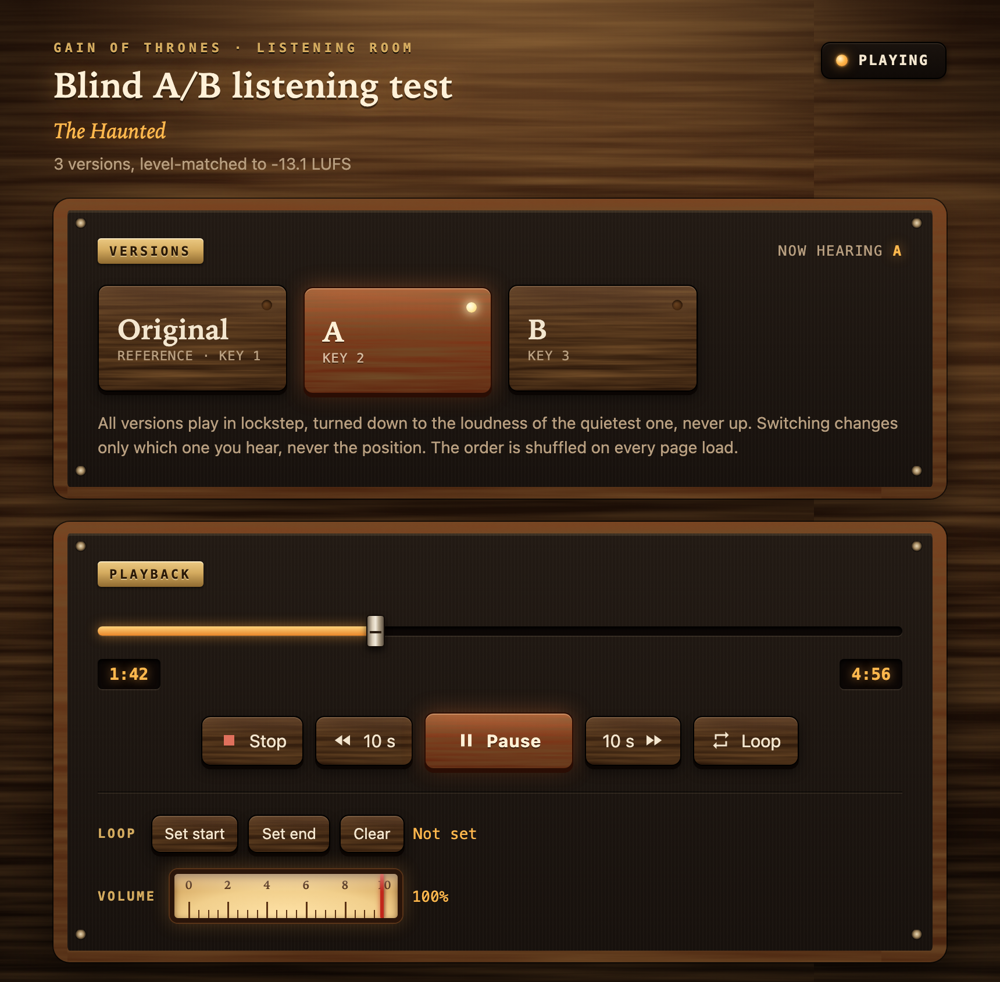
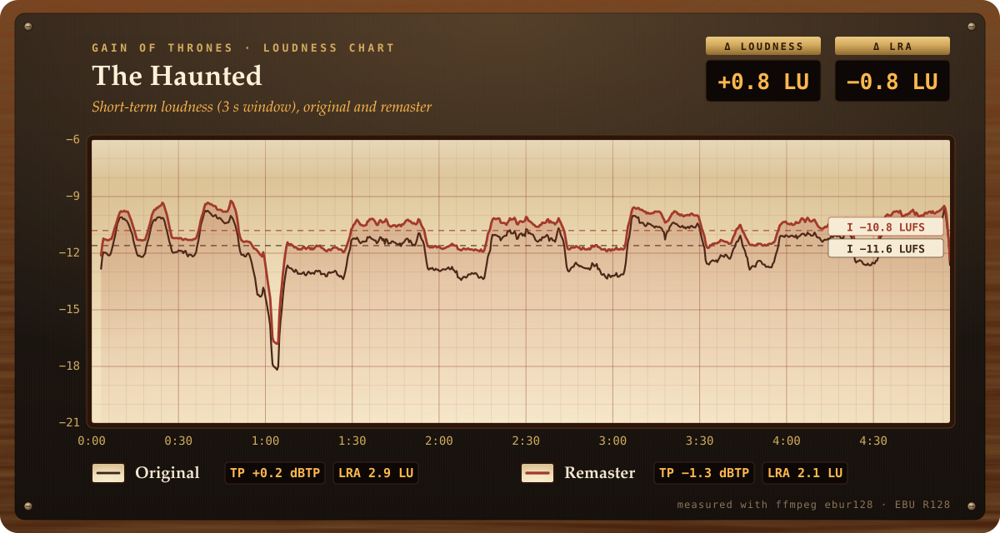

# Gain of Thrones

**You and your AI agent are the audio engineer.** You listen and decide; the agent measures, renders, and tells you what the numbers mean.

Gain of Thrones remasters music you own, such as CD rips or lossless files. It splits each track into drums, bass, vocals and "other" with Demucs, fixes balance and masking on each stem within limits set by research, adds back everything the split missed, and limits the result without clipping. Every render is measured before you hear it. Every comparison is a blind, level-matched A/B in your browser, so a version can't win just by being louder.



> **Heads-up:** on a Mac, splitting a 45-minute album takes close to **3 hours of CPU time** (it runs in the background). Details under [What to expect](#what-to-expect).

## How a session goes

1. Set it up once (below), then open [Claude Code](https://claude.com/product/claude-code) in this folder.
2. Say something like: *"remaster my album in ~/Music/Some Album"*.
3. The agent measures your rips and tells you, in plain words, how loud, squashed or clipped they are. You tell it what you'd like to hear different: "the vocals are buried", "the cymbals vanish when it gets loud", or simply "a bit louder".
4. It renders one track, measures it, and opens a blind A/B page. You pick by ear, then reveal.
5. One change at a time until you're happy, then the whole album with one loudness shift for every track (so the song-to-song flow survives), or only the tracks you pick, and copies in the formats you choose (MP3, AAC, FLAC, ALAC or WAV) with your tags and cover art, as far as each format holds them.

`got plot` charts what a remaster did. Here, a track from a heavy metal CD against the `heavy-guitar` preset at -10.8 LUFS: 0.8 LU louder, and true peak down from +0.2 dBTP (over full scale) to -1.3 dBTP.



## Setup (once)

- **ffmpeg** on your PATH: `brew install ffmpeg` (macOS), `winget install ffmpeg` (Windows), `sudo apt install ffmpeg` (Debian/Ubuntu).
- **uv**: see [docs.astral.sh/uv](https://docs.astral.sh/uv/).
- **Claude Code**: see [claude.com/product/claude-code](https://claude.com/product/claude-code).

Then:

```bash
git clone https://github.com/alitahir6001/gain-of-thrones.git
cd gain-of-thrones
uv sync
claude
```

`uv sync` builds a Python 3.11 environment with pinned versions. The first split downloads about 340 MB of Demucs model weights from Hugging Face. In Claude Code, tell it which album.

## What to expect

- **Time.** Splitting runs on the CPU on Macs: about 3.8 s per second of audio on an M1 Max, so a 45-minute album takes close to 3 hours. The agent runs it in the background. On Linux, an NVIDIA GPU is used automatically (untested here).
- **Disk.** About 5 GB of working files for a 45-minute album, kept in `work/` (never committed).
- **Genres.** The research so far covers heavy metal and punk ([docs/research](docs/research/README.md)). For other music, the agent can research the genre and draft a preset ([docs/adding-a-genre.md](docs/adding-a-genre.md)), and you test it blind before it's kept.
- **Limits.** Separated stems aren't clean, so the moves stay small (EQ within 3 dB, stem levels within 2 dB). This is a careful remaster of a finished master, not a remix from the multitracks. Clipping already printed on the CD stays.
- **Platforms.** macOS on Apple Silicon is tested. Linux and Windows are untested. Intel Macs are not supported (current PyTorch has no builds for them).

## Docs

- [docs/listen-and-measure.md](docs/listen-and-measure.md): the method, for people, with the lessons learned.
- [docs/agent-tools.md](docs/agent-tools.md): the `got` command the agent uses.
- [.claude/skills/remaster-session/SKILL.md](.claude/skills/remaster-session/SKILL.md): the session script the agent follows.

## License

GPL-3.0-or-later (see [LICENSE](LICENSE)), because it uses pedalboard (GPL-3.0). Demucs and pyloudnorm are MIT.

The htdemucs model weights are not part of this repo; Demucs downloads them. Their license is unclear: the maintained Demucs repository says MusDB, part of their training data, ["contains some data that were only usable for research purpose"](https://github.com/adefossez/demucs). Remasters of commercial records are for your personal listening.
